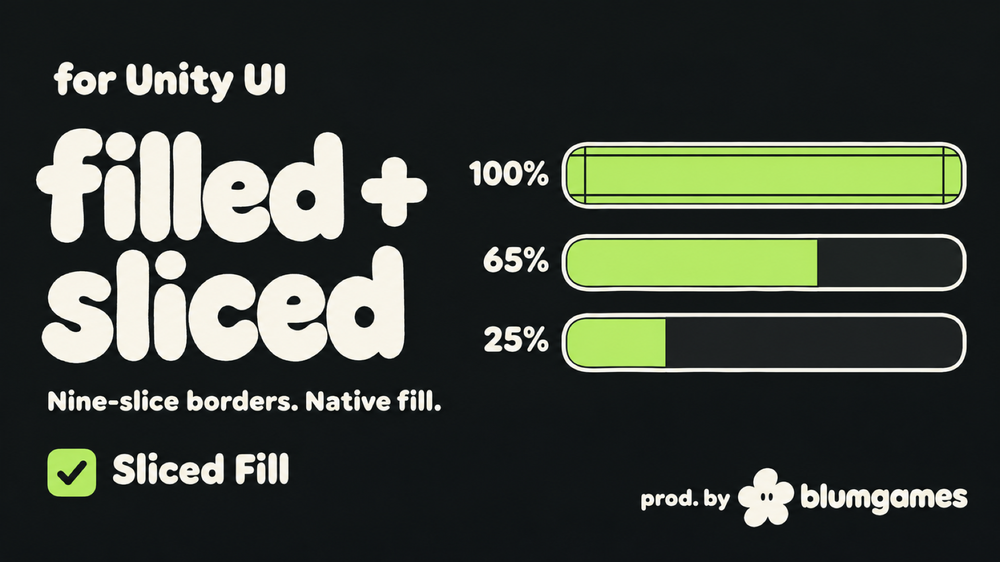

# Sliced Fill for Unity UI



**Nine-slice borders. Native fill. One checkbox.**

Sliced Fill adds nine-sliced sprite geometry to a standard Unity uGUI `Image` with `Image Type = Filled`. Keep using `fillAmount`, your existing references and animations. Enable **Sliced Fill** directly in the Image inspector.

Created by **blumgames** · MIT licensed · Unity 2022.3 LTS or newer

**[Download the latest .unitypackage](https://github.com/Betoraf/unity-sliced-fill/releases/latest)** · [Direct download](Downloads/Blumgames.SlicedFill-1.0.1.unitypackage?raw=true) · [Changelog](CHANGELOG.md)

## Why it exists

Unity's standard Image offers `Sliced` and `Filled` as separate types. A filled progress bar can distort the sprite's borders when its RectTransform differs from the source sprite's proportions.

This package builds the full-size nine-sliced image, then reveals only the filled portion. Reducing Fill Amount crops the artwork; it does **not** squeeze it or move the opposite rounded end cap inward.

## Install in a minute

1. Download and import `Blumgames.SlicedFill-1.0.1.unitypackage`.
2. Select a standard **UI → Image** and assign a sprite with non-zero **Border** values. Set them in **Sprite Editor → Border → Apply** if needed.
3. Set **Image Type → Filled**.
4. Tick **Sliced Fill** in the same Image inspector.
5. Adjust **Fill Amount**, **Fill Method** and **Fill Origin** normally.

When enabled, **Fill Center** and **Pixels Per Unit Multiplier** appear below the checkbox. A larger multiplier makes the borders thinner.

For a ready-made example, drag `Assets/Blumgames/SlicedFill/Samples/Rounded Progress Bar.prefab` into a Canvas. It references Unity's built-in UI sprite; no artwork download is needed.

Alternatively, copy `Assets/Blumgames` and its `.meta` files from this repository into your project. This repository is an asset package, not a complete Unity project or a UPM Git package.

## Supported behavior

| Feature | Behavior |
| --- | --- |
| Horizontal and Vertical | Crops the full-size sliced sprite, with both origins supported |
| Radial 90, 180 and 360 | Uses Unity's fill sectors, including origins and clockwise direction |
| Fill Amount | Uses the existing `Image.fillAmount` property |
| Fill Center | Can omit the center slice |
| Border sizing | Uses the sprite borders and Pixels Per Unit Multiplier |
| Edit and Play Mode | Updates when the Image mesh is rebuilt |
| Prefabs and Undo/Redo | Supports overrides, scene reloads and multi-object editing |
| Missing or borderless sprite | Falls back to the standard Image behavior |

## Existing code keeps working

```csharp
using UnityEngine;
using UnityEngine.UI;

public sealed class HealthBar : MonoBehaviour
{
    [SerializeField] private Image fill;

    public void SetHealth(float current, float maximum)
    {
        fill.fillAmount = maximum > 0f
            ? Mathf.Clamp01(current / maximum)
            : 0f;
    }
}
```

No replacement Image, custom shader, extra Canvas, TextMeshPro or tween library is required. The runtime has no `Update` loop and reuses its geometry buffers.

## Notes

- This is **uGUI**, not UI Toolkit.
- The cut edge is straight, as in standard Filled. At 25%, you see the first quarter of the full-size sliced image, not a smaller fully rounded bar.
- **Preserve Aspect** is ignored while enabled, matching standard Sliced behavior.
- The clickable area is not reduced to the visible fill, matching standard Filled behavior.
- Changing to another Image Type temporarily bypasses the effect. Disabling the checkbox restores native Filled rendering.
- The checkbox manages a small hidden `Blumgames.UI.SlicedFill` component. It is placed before Outline, Shadow and other mesh effects. Keep that order if manually rearranging components.
- Another plugin that replaces the standard Image inspector may take priority. Custom Image subclasses are not overridden.

## Compatibility checks

Version **1.0.1** was imported into fresh **Unity 2022.3.62f3** and **Unity 6000.3.27f2** projects. Checks covered all five fill methods, origins and directions, small and full fills, several pivots and sizes, UV mapping against native Sliced geometry, inspector setup, Undo/Redo, prefab overrides, scene reloads and live mesh updates.

A rendered preview was also checked in the Unity 2022.3 Editor. Other Unity releases and individual target-device builds were not separately tested.

## Updating or removing

Import the newer package over the existing files. Script GUIDs are preserved, so existing component references remain intact.

Before deleting the package, remove its hidden SlicedFill components from scenes and prefabs. The Inspector's **Debug** mode exposes them. Deleting scripts alone leaves missing-component references.

## License and author

Code and sample: [MIT License](LICENSE), copyright © 2026 **blumgames**. Free to use and modify in personal and commercial projects, with the license notice retained.

The blumgames name and logo identify the original author; they do not imply endorsement of modified versions.

Found a problem? [Open an issue](https://github.com/Betoraf/unity-sliced-fill/issues) with your Unity version, fill settings and a screenshot.
